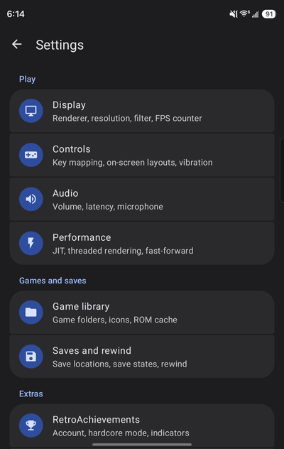
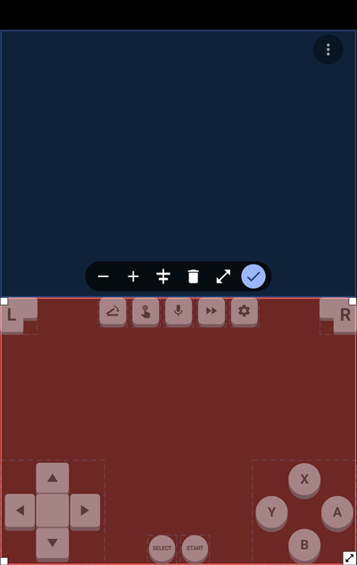
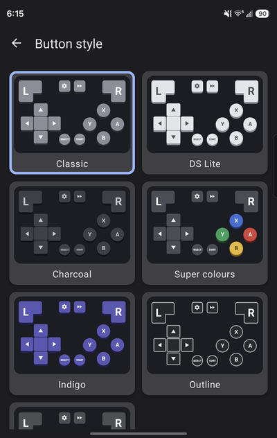

# melonadeDS
A fork of the [melonDS Android port](https://github.com/rafaelvcaetano/melonDS-android), itself an Android port of [melonDS](https://melonds.kuribo64.net/), a DS and DSi emulator. Needs Android 10 or newer.

|Settings|Layout Editor|Button Styles|
|---|---|---|
||||

# What this fork adds
*  Material 3 settings with Material You colors, and an English-only UI
*  Controller button styles, in game and in the layout editor
*  A layout editor with snapping, a grid and aspect-ratio locks
*  WideMelon, a widened 3D view for wide layouts, and per-game Lua scripts (see [MODS.md](MODS.md))
*  Upscaled display capture, so captured screens stay sharp at higher internal resolutions
*  Smooth gradients, which blends hard color steps before any screen filter
*  Precise depth (off by default), which fixes flickering ground shadows and decals
*  Frame pacing to the display's vsync, with an optional 60 Hz lock
*  Settings backup and restore, and automatic save backups you can restore from the game's details screen
*  A performance log and a debug log

Not supported: local multiplayer and DSi SD cards. Full speed needs a 64 bit device with JIT and thread rendering on; 32 bit devices have no JIT and run poorly.

# Third-party frontends
ROMs must already be scanned by melonadeDS. Then point the frontend at:
*  Package: `io.github.neytotheney.melonadeds` (`io.github.neytotheney.melonadeds.nightly` for nightly). This is a different package from upstream melonDS (`me.magnum.melonds`), so it installs beside it.
*  Activity: `me.magnum.melonds.ui.emulator.EmulatorActivity`
*  Intent data: the ROM's URI (NDS, ZIP or 7z), with [read permission granted](https://developer.android.com/reference/android/content/Intent#FLAG_GRANT_READ_URI_PERMISSION). The older `uri` and `PATH` string extras still work but are deprecated.

Pegasus metadata: [melonds.metadata.txt](./.github/pegasus/melonds.metadata.txt), [melonds-nightly.metadata.txt](./.github/pegasus/melonds-nightly.metadata.txt).

If a launched ROM wasn't scanned before, its save goes to `Android/data/io.github.neytotheney.melonadeds/files/saves` instead of next to the ROM.

# Building
You need JDK 21+, the Android SDK, NDK and CMake.

```
git clone --recurse-submodules https://github.com/NeytotheNey/melonadeDS.git
./gradlew :app:assembleGitHubProdDebug -Pandroid.injected.build.abi=arm64-v8a
```

Use `gradlew.bat` on Windows, and `x86_64` instead of `arm64-v8a` for the Android emulator. The APK lands in `app/build/intermediates/apk/gitHubProd/debug/`. To install it with `adb install`, add `-Pandroid.injected.testOnly=false`.

Flavors are `gitHub` (also builds 32 bit ARM) or `playStore`, crossed with `prod` or `nightly`. Debug builds install beside the release app as `io.github.neytotheney.melonadeds.dev` and have optimized native code, so they work for performance tests; add `-PnativeBuildType=Debug` for an unoptimized native build.

There's also a Windows desktop build in `desktop/` for testing the core and renderers without a phone (see `desktop/README.md`).

Release builds need `MELONDS_KEYSTORE`, `MELONDS_KEYSTORE_PASSWORD`, `MELONDS_KEY_ALIAS` and `MELONDS_KEY_PASSWORD` in `local.properties`.
